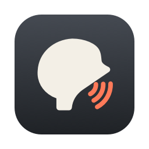

<p align="center"></p>
<h1 align="center">Papo Reto</h1>

<p align="center"><strong>Free, open source voice dictation for macOS, made for Brazilian Portuguese. Hold <code>Fn</code>, speak, release: the text appears at the cursor. Nothing leaves your Mac.</strong></p>

<p align="center">
  <a href="https://github.com/ewerttonbravo/papo-reto/releases/latest"></a>
  <a href="LICENSE"></a>
  
</p>

<p align="center">
  <picture>
    <source media="(prefers-color-scheme: dark)" srcset="assets/menu-bar-dark.png">
    
  </picture>
</p>

## Why Papo Reto
- **Free:** MIT licensed, no account, no subscription, no word limit.
- **Private:** audio and text never leave your Mac. The only network use is the one-time model download.
- **PT-BR first:** built and tested with Brazilian Portuguese speech, punctuation included.
- **Light:** a native menu bar app (36 MB without the model), 0% CPU while idle, and the microphone is on only while you dictate.

## How it works
1. **Hold** `Fn` in any app.
2. **Speak.** A sound confirms that recording started.
3. **Release.** The speech is transcribed on your Mac, about 1 s for 10 s of speech on a 2020 Intel MacBook Pro.
4. **Done.** The text is pasted at the cursor.

For longer dictation, double-tap `Fn` to record hands-free and press `Fn` again to stop. `Esc` cancels.

## Features
- **Works in any app** with a text field: it pastes with Cmd+V, and your previous clipboard comes back right after.
- **Smart spacing:** reads the character on each side of the cursor, so consecutive dictations do not stick together and no stray spaces pile up.
- **Recent:** the last 10 dictations in the menu bar, one click to paste again, so a dictation with no text field in focus is not lost. Kept in memory only.
- **Ignores silence and noise:** a voice detector (Silero VAD) skips recordings with no speech, so nothing made up gets pasted.
- **Choose your microphone** in the menu bar; the choice is saved and falls back to the system default when the device is unplugged.
- **Respects your clipboard:** passwords from a password manager are never restored, and clipboard managers that honor `org.nspasteboard.TransientType` skip the dictation.

## Install
1. Download the `x86_64` zip from [Releases](https://github.com/ewerttonbravo/papo-reto/releases/latest). It is built and tested for Intel Macs (Apple menu → About This Mac); on Apple silicon (M1 and later), [build from source](#build-from-source) for now. Requires macOS 13+.
2. Unzip it and move `PapoReto.app` to Applications.
3. The app is not notarized by Apple, so macOS blocks the first launch. Open it once, then click "Open Anyway" in System Settings → Privacy & Security; or run:
   ```sh
   xattr -dr com.apple.quarantine /Applications/PapoReto.app
   ```
4. Grant Accessibility when asked (to read the `Fn` key and send Cmd+V) and the Microphone on the first dictation. Until Accessibility is granted, the menu's "Allow Accessibility…" opens its settings.
5. Set System Settings → Keyboard → "Press 🌐 key to" → "Do Nothing", or macOS also acts on `Fn`.

On the first launch the app downloads the model (671 MB, from Hugging Face), with the progress in the menu, and checks each file's SHA-256.

## Known limitations
- The prebuilt app is tested on Intel Macs only; the Apple silicon build is not tested yet.
- The app is signed ad-hoc, so each new version asks for Accessibility and the Microphone again (macOS ties permissions to the signature). The app clears its old Accessibility record itself.
- The model was trained with more European than Brazilian Portuguese: very short phrases may come out in Spanish, and it adds punctuation even to a single word.
- The model stays in memory for instant transcription: about 460 MB after loading. After a long dictation (from ~20 s) it reloads to give memory back (hourglass icon for a few seconds).
- Apps that do not expose their text to Accessibility (some Electron editors, the Google search box in Safari) get a space at the end of each dictation instead of smart spacing.
- A recording stops by itself at 2 minutes and is transcribed whole.

## Performance
Measured on the reference Mac, a 2020 Intel MacBook Pro (i5-1038NG7, 4 cores, 16 GB):

| Metric | Measured | Budget |
|---|---|---|
| Transcription, per 10 s of speech | 0.93-1.00 s | < 1.5 s |
| Model load at launch, in the background | ~3 s | < 5 s |
| Memory after loading the model | ~460 MB | < 900 MB at rest |
| CPU while idle | 0.0% | ~0% |
| App size without the model | 36 MB | < 45 MB |

## Build from source
Requires macOS 13+ and the Command Line Tools (`xcode-select --install`) or Xcode.

```sh
make test   # tests + 100% line coverage on PapoRetoCore
scripts/fetch-deps.sh model  # Parakeet TDT 0.6B v3 int8 (~670 MB, SHA-256 checked) for the bench; the app downloads it itself
make install  # builds the app and installs it in /Applications, quitting and reopening a running one
make app    # builds build/PapoReto.app for local use
make release  # ad-hoc zips for arm64 and x86_64 in build/release, each checked by scripts/check-release.sh
make showcase  # redraws the README and social preview images in assets/ after a change to the icon
make run    # builds and opens the app
```

Optional, once per Mac: `scripts/dev-cert.sh` creates a free self-signed certificate, "Papo Reto Dev", in your login keychain (macOS asks for your password to trust it for code signing). `make app` and `make install` then sign with it, and the Microphone and Accessibility permissions survive rebuilds. Without it, they sign ad-hoc and macOS asks for them again after each build.

At every launch the app checks the model's file sizes and downloads again any file that is missing or truncated; an interrupted file starts over. If the download fails, the menu offers Retry. `make test` and `make app` download the prebuilt [sherpa-onnx](https://github.com/k2-fsa/sherpa-onnx) libs into `vendor/`, checking their SHA-256.

### Benchmark
```sh
make bench BENCH_AUDIO=<dir with WAVs>  # text, latency and RAM per file, 3 runs
```

`make bench` fails unless 2 of the 3 runs stay within the performance budget (model load, slowest file per 10 s of speech, final memory footprint).

## Acknowledgments
- [Arara](https://github.com/davimatosms/Arara-voice), which inspired Papo Reto.
- [NVIDIA Parakeet TDT 0.6B v3](https://huggingface.co/nvidia/parakeet-tdt-0.6b-v3) (CC-BY-4.0), the speech recognition model, in the int8 export by sherpa-onnx.
- [sherpa-onnx](https://github.com/k2-fsa/sherpa-onnx), which runs the model natively.
- [Silero VAD](https://github.com/snakers4/silero-vad), the voice detector.

## License
MIT. See [LICENSE](LICENSE). The bundled libraries and the model keep their own licenses: see [THIRD_PARTY_NOTICES.md](Resources/THIRD_PARTY_NOTICES.md).
